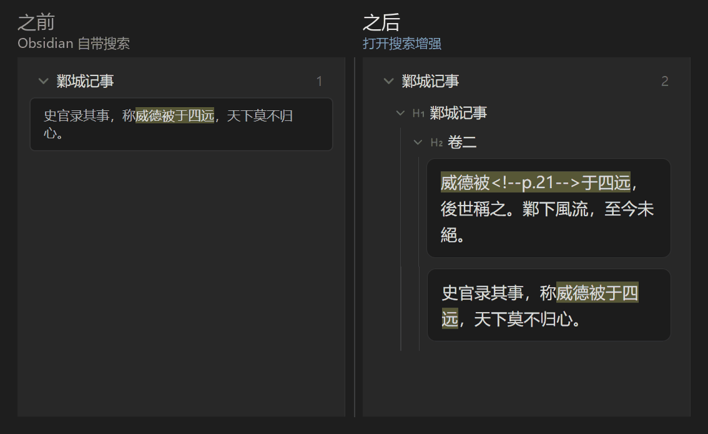
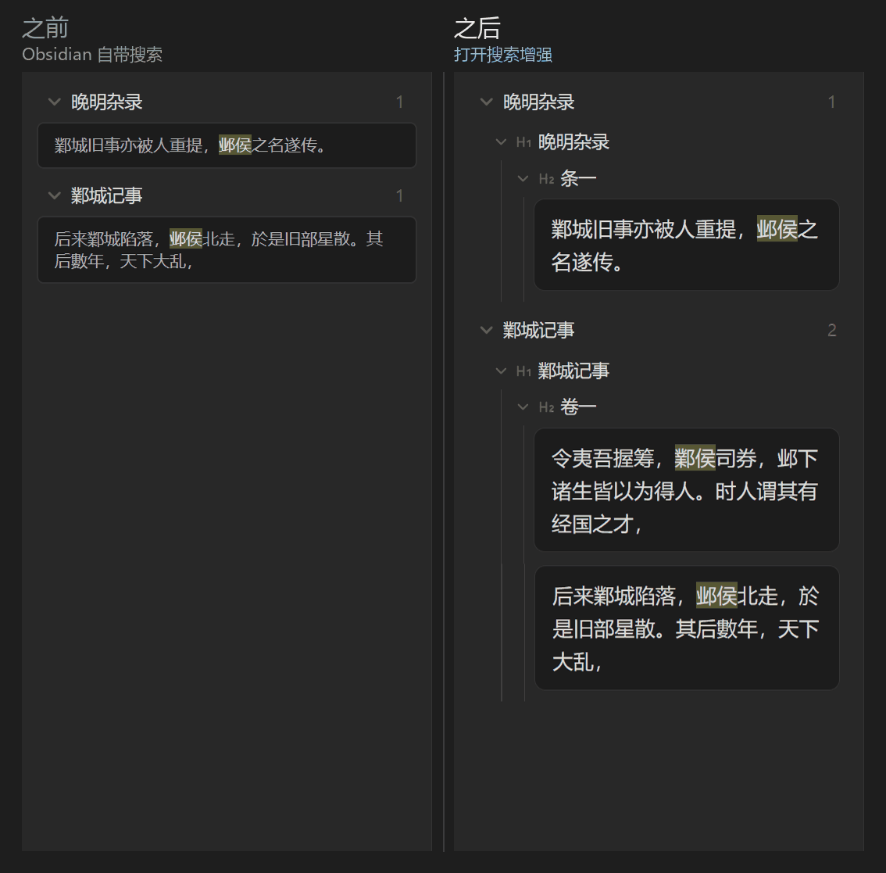
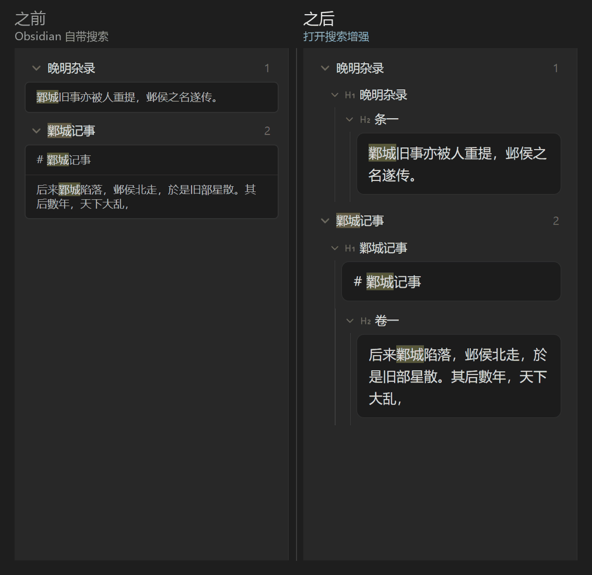
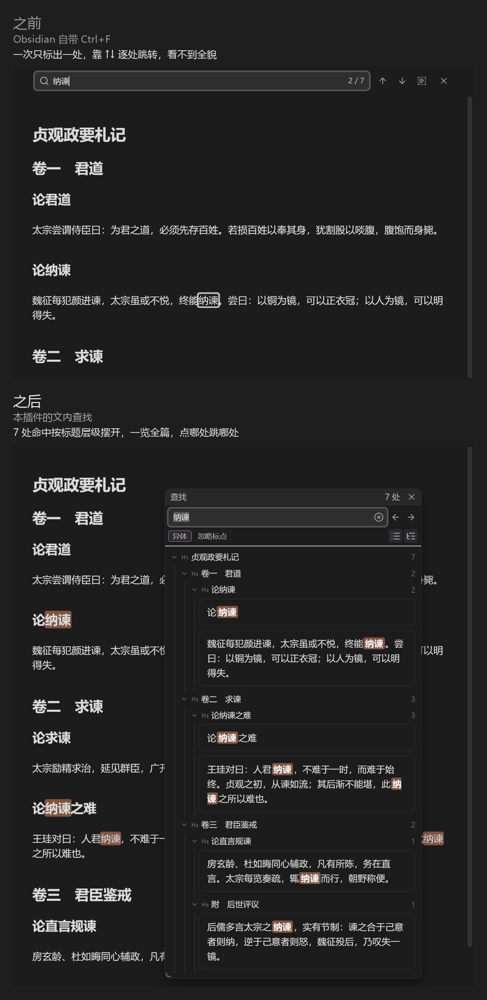
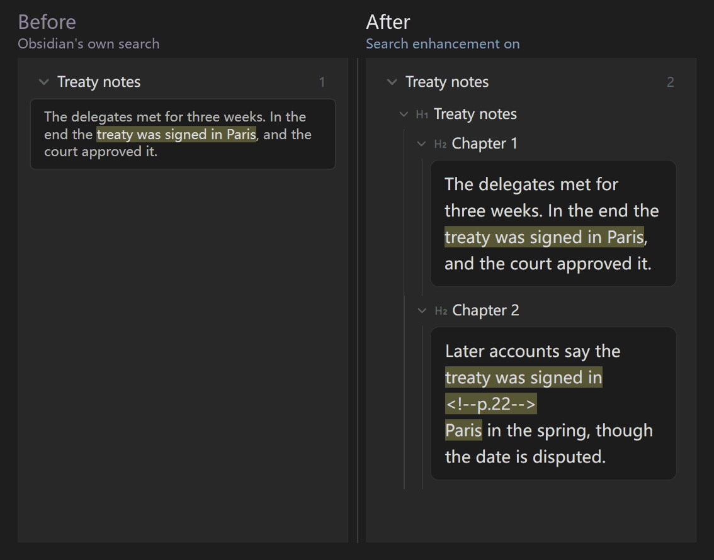
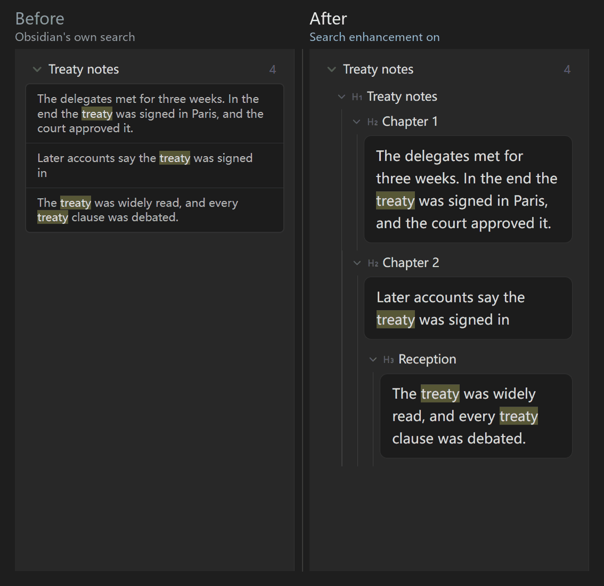
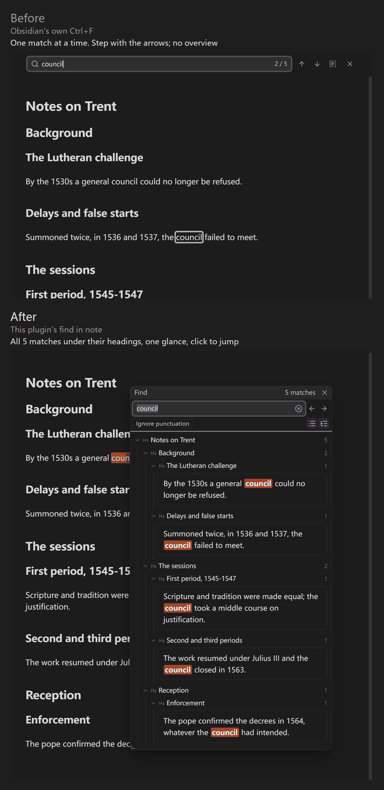

# Better Search Result Views（更好的搜索结果展示）

本插件优化了 Obsidian 的搜索结果展示方式：

- **结果按标题归类。** 命中归在各自的标题层级下面（文件 → 一级标题 → 二级标题 → 命中所在的段落），命中字高亮，标题可折叠；同一段里的几处命中合成一张卡片。
- **文内查找。** 当前笔记里按 `Ctrl+F`（可选接管），弹出面板列出全部命中，点哪条跳哪条；不用再靠上下箭头逐处翻。
- **侧栏搜索。** 范围可选当前文件、当前文件夹或全库；也可以让 Obsidian 自带的搜索面板直接显示成标题树（默认开启，可在设置里关）。
- **切开的词也找得到。** 词被换行、HTML 标签、`%%备注%%`、脚注号或页码标记切开，照样命中。
- **两种显示，面板上可切换。** 树形（见上）和紧凑（一处一行）；侧栏默认树形，文内查找默认紧凑。
- **读中文古籍、史料转写的人另有两样。** 异体字当同一个字找（「鄴／邺」「於／于」「後／后」互通，对照表只用于检索，不改你的笔记）；笔记里用 `<!--p.12-->` 标出原书页码的话，结果会带页码（格式见下面的「页码标记」）。其他用途可以不管它们。

本插件独立开发，与 [Better Search Views](https://github.com/ivan-lednev/better-search-views) 没有隶属关系，参考关系见文末「致谢」。

不联网、无遥测、不需要账号，电脑和手机都能用。界面语言跟随 Obsidian：中文和繁体中文显示中文，其余显示英文（英文界面默认不显示异体字功能，需要的话在设置里打开）。第一次启用时会弹出一个功能介绍，之后可以在命令面板里用「查看功能介绍」再打开。

## 效果对比

下面四组都是同一份笔记、同一个搜索词的真实截图。前三组是侧栏搜索：左边是 Obsidian 自带搜索，右边是开启设置里的「增强 Obsidian 自带搜索」之后（默认开启）；第四组是文内查找。

**词被页码标记切开**：搜「威德被于四远」，自带搜索只找到没被切开的那一处；打开后，被 `<!--p.21-->` 页码标记切开的那一处也找到了。



**异体字等同**：搜「邺侯」，自带搜索只找到写成「邺侯」的 2 处；打开后写成「鄴侯」的也算，共 3 处。



**按标题归类的结果**：搜「鄴城」，自带搜索把结果平铺；打开后按标题归成树，每个标题都能折叠。



**文内查找（Ctrl+F）：按标题一览**：同一篇有多级标题的笔记里搜「纳谏」。自带的 Ctrl+F 一次只标出一处，要靠上下箭头逐处跳转；本插件的查找面板把 7 处命中按「卷 → 篇」的标题层级列出来，一眼看全篇，点哪处跳哪处。（这一组上下排开：上面是自带，下面是本插件。）



## 使用

命令面板里的命令名（英文界面下是对应的英文）：

- **文内查找（带结果列表）**：打开正文上的浮动面板；有选中的文字就拿它当查询。
- **查找（异体字、跨页）**：打开侧栏。左侧功能区的搜索图标同样可以打开。
- **用选中的文字做异体扩展搜索（Obsidian 自带搜索）**：把选中的字改写成覆盖其异体的正则，交给 Obsidian 自带搜索。
- **Obsidian 自带的文内查找**：接管 `Ctrl+F` 之后，仍可从这里调出自带的查找条（含替换）。
- 面板上的开关：异体、忽略标点、跨页码与折行、跨标注与注释、结果显示（树形／紧凑）。

## 设置

所有设置在一页里：自定义异体组（一行一组，如 `於于`）、Unicode Unihan 的三张通用表（繁简对应、同字异写、语义异体）、最多列出几处、文内查找是否接管 `Ctrl+F`，以及面板的位置与大小。

## 页码标记

如果你的笔记是古籍或整理本的转写，在第 N 页开始的地方写一条 HTML 注释形式的页码标记：`<!--p.N-->`，N 是整数（卷首没有印刷页码时可以写负数，如 `<!--p.-3-->`）。标记里允许多几个空格，如 `<!-- p.12 -->`。

- 只有这种格式会被认作页码标记。`[p.12]`、`<p12>`、`第12页` 这类写法**不会**被识别。
- 认得出页码标记以后：侧栏里每条结果会显示它所在的页码；被页码标记切开的词也能找到（见上面的对比图）。
- 没有写这种标记的笔记，一样能搜、能按标题归类，只是不显示页码。

## 致谢

树形显示的思路参考了 ivan-lednev 的 [Better Search Views](https://github.com/ivan-lednev/better-search-views)（MIT 许可）：它把 Obsidian 自带的搜索结果显示成带标题层级的大纲。本插件没有使用它的代码，自己的两个面板是自己绘制的；只有开着设置里的「增强 Obsidian 自带搜索」时（默认开启），才会读取并改动自带搜索面板（详见下一节），反向链接和嵌入查询不受影响。

## 增强 Obsidian 自带搜索

设置里的「增强 Obsidian 自带搜索」默认开启，可随时关掉。开着的时候，Obsidian 自带的「搜索」面板有两处变化：

- **搜索增强选项。** 在搜索框右边 ⚙ 打开的菜单里，原有的三个开关下面多出一组「搜索增强」：异体字等同、跨页码与折行、跨标注与注释、忽略标点、只搜标题。有选项在起作用时，⚙ 按钮上会亮一个小圆点。第一次用到这个功能时，菜单会替你展开一次，之后听你自己的。
- **标题树。** 每条结果前补上它所在的标题行，按层级缩进，点标题行可折叠或展开它下面的结果。

它是怎么起作用的：

- 勾选的选项只在**搜索的那一刻**把你输入的词改写成 Obsidian 搜索认得的正则，搜索框里的字不动，保存下来的搜索也不变。
- 只改写普通的词和引号短语。`path:`、`tag:`、`file:`、`line:` 这类操作符，自己写的 `/正则/`、`[属性]`、`OR`、括号、排除符 `-` 原样保留；面板会提示这部分不受选项影响。
- 这组选项和侧栏面板共用同一份勾选。
- 它是用正则去近似本插件自己面板的匹配规则，自己的面板仍是最精确的。

要知道的限制：

- **它读取并改动自带搜索面板的内部结构**（Obsidian 没有为此提供公开接口），所以 Obsidian 升级后可能失效。对不上或出错时会自动撤销并停用，不影响本插件的其他功能。
- 关掉这个开关会立即还原成原样。
- 「只搜标题」用到后行断言；老 iOS（16.4 以前）不认，那里会退回把标题标记也算进命中的写法。
- 折叠状态只在当前搜索面板里记着，不写入文件。

## 数据与许可

Unihan 异体表由 Unicode 字符数据库（Unihan，Unicode License v3）生成，详见 `THIRD_PARTY_NOTICES.txt`。本插件以 MIT 许可发布。

## 开发

```
npm install
npm run build   # 生成 dist/main.js、dist/styles.css、dist/manifest.json
npm test
npx eslint src  # 官方的 Obsidian 审查规则
npm run unihan -- <Unihan.zip>   # 重新生成 Unihan 对照表
```

---

# Better Search Result Views (English summary)

This plugin improves how Obsidian shows search results:

- **Results grouped by heading.** Each match sits under its heading levels (file, then H1, H2, and so on, then the paragraph holding the match) with the match highlighted. Headings fold, and several matches in one paragraph share a card.
- **Find in note.** Press `Ctrl+F` (taking it over is optional) to get a panel that lists every match in the note; click one to jump to it instead of stepping with the arrows.
- **Sidebar search.** Search the current file, the current folder or the whole vault. Obsidian's own Search panel also shows its results as a heading tree, with a group of search options in its ⚙ menu (on by default; switch it off in settings).
- **Search across breaks.** Words split by a line break, an inline HTML tag, a `%%comment%%`, a footnote mark or a page marker are still found.
- **Two views, switchable on the panel.** Tree (above) and compact (one line per match); the sidebar defaults to tree, find in note to compact.
- **Two extras if you read Chinese historical texts.** Variant characters count as the same (`鄴` and `邺`, `於` and `于`, `後` and `后`; the table is used for searching only and your notes are never rewritten), and page markers such as `<!--p.12-->` show up as page numbers in the results. You can ignore both otherwise.

An independent plugin, not affiliated with [Better Search Views](https://github.com/ivan-lednev/better-search-views) (see Acknowledgements).

No network access, no telemetry, no account; works on desktop and mobile. The interface follows Obsidian's language (Chinese, or English otherwise). In the English interface the variant-character features are hidden by default (turn them on in settings if you read Chinese sources). A short feature guide opens the first time the plugin is enabled; reopen it any time with the command "Show feature guide".

**Page markers.** If your notes mark where a printed page starts with an HTML comment such as `<!--p.12-->` (the number may be negative, and spaces inside the comment are fine), search results show the page number and words split by the marker are still found. Other styles such as `[p.12]` or `<p12>` are not recognised. Notes without such markers can still be searched and grouped by heading; they just don't show page numbers.

**Before and after** (same notes, same query; left: Obsidian's own search, right: with the "Enhance Obsidian search" setting on, which is the default). Put a phrase in quotes so Obsidian treats it as one phrase.





**Find in note (Ctrl+F).** Obsidian's own Ctrl+F marks one match at a time; this plugin's panel lists every match under its headings. Top: Obsidian; bottom: this plugin.



Licence: MIT; Unihan data under the Unicode License v3 (see `THIRD_PARTY_NOTICES.txt`).

Acknowledgements: the tree view follows the idea of Better Search Views by ivan-lednev (MIT), which shows Obsidian's own search results as an outline of heading breadcrumbs. This plugin does not use its code and draws its own two panels. A setting (on by default, can be switched off) enhances Obsidian's built-in Search: a "Search enhancement" group of checkboxes (variants, across page markers and line breaks, and more) appears in the search settings menu, and results get heading levels and folding. The options only rewrite the words you type into a regular expression while a search runs. It reads and modifies that panel's internal structure, so it may stop working after an Obsidian update, in which case it turns itself off. Backlinks and embedded queries are not touched.
